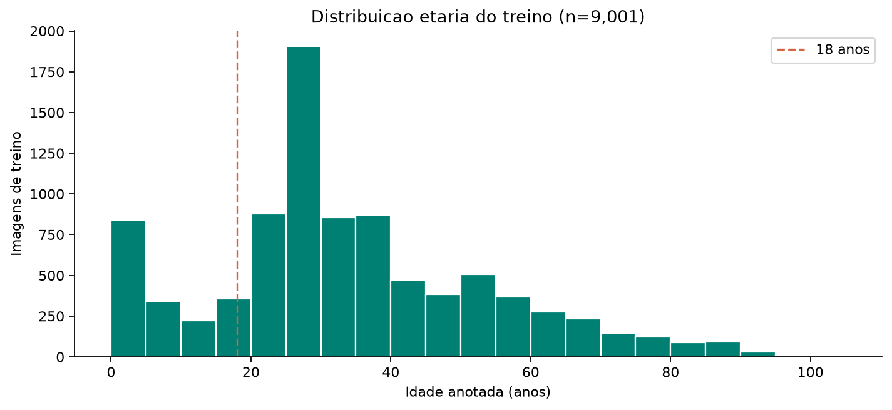
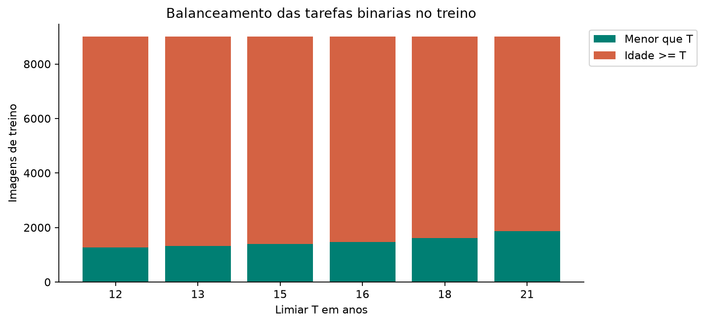
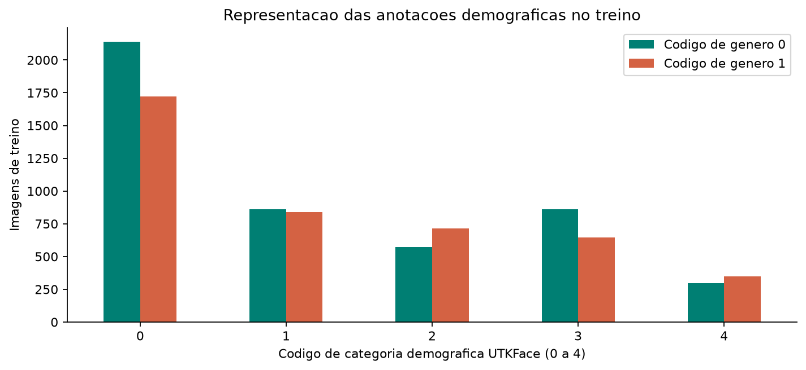
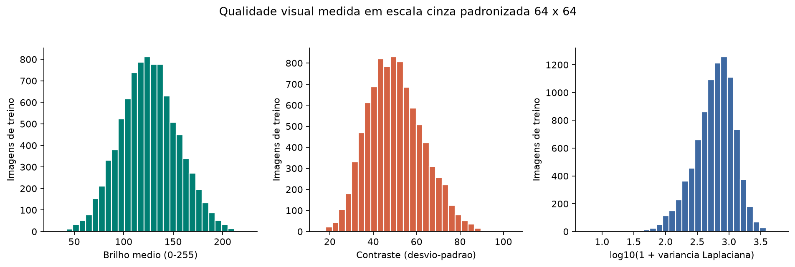
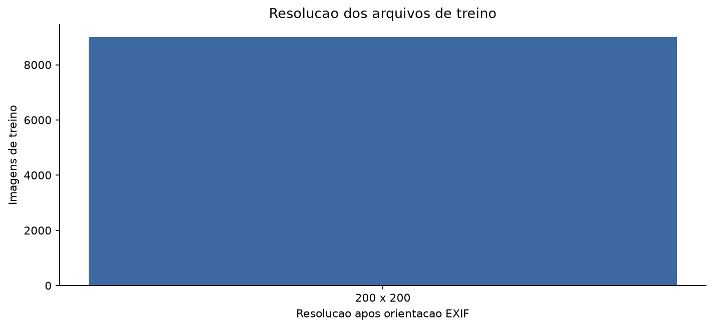
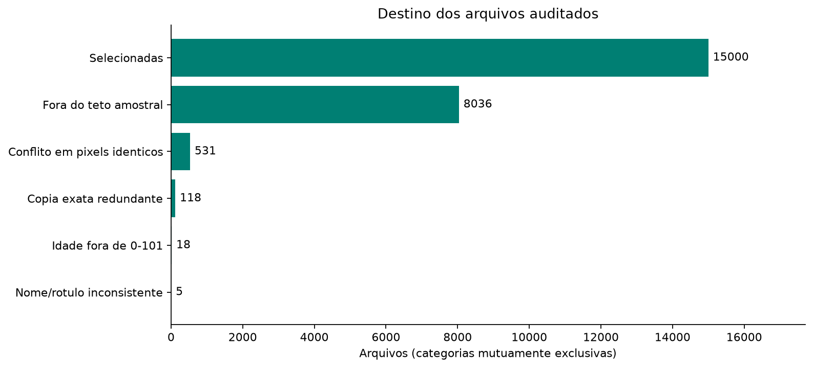
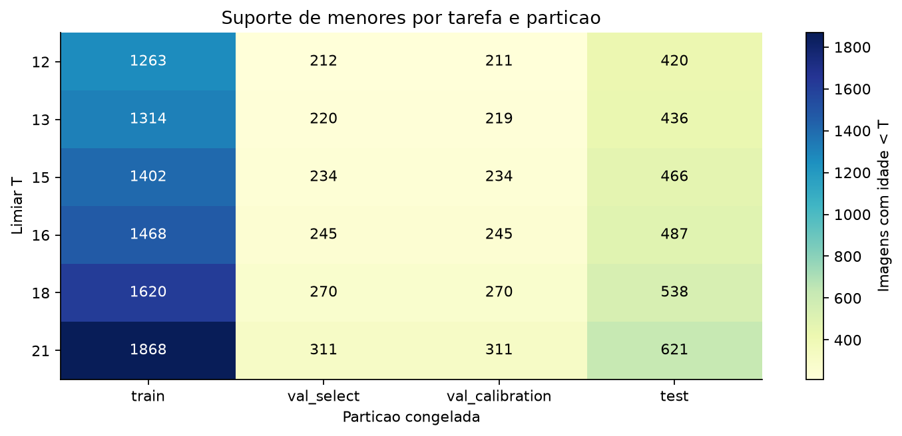
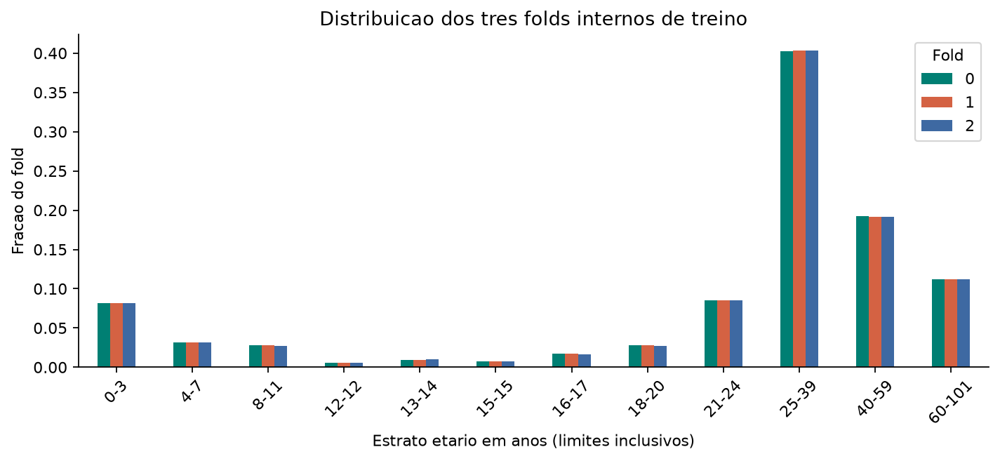

# AgeLens | Task 04

## Auditoria integral e EDA

Arquivos auditados: 23708. Imagens selecionadas: 15000.
Particoes: {'train': 9001, 'test': 3000, 'val_select': 1500, 'val_calibration': 1499}.

Auditoria tecnica nao confirma idade documental, identidade ou consentimento das pessoas.
Nao houve treinamento. A EDA de atributos usa apenas o treino; os demais splits aparecem somente em verificacoes de suporte e integridade.

## Referencia e duplicatas

Metadados de referencia: 23035 de 23036 elegiveis correspondem; 256 grupos conservadores cruzariam as particoes originais. Aplicado o fallback predefinido, com grupos indivisiveis.
Correspondencia de metadados nao prova identidade. Grupos perceptuais sao precaucao contra copias proximas, nao reconhecimento facial nem verificacao humana exaustiva.

## 1. Distribuicao de idade

O treino tem 9001 imagens, idade media 33.13, mediana 29 e intervalo 1 a 100 anos. Menores de 18 somam 1620 (18.0%). A distribuicao nao e uniforme; MAE global pode ocultar erros nas idades jovens. Idades extremas validas foram mantidas dentro do recorte, sem remocao por serem raras.

## 2. Balanceamento por limiar

Proporcoes positivas no treino: <12: 14.0%, <13: 14.6%, <15: 15.6%, <16: 16.3%, <18: 18.0%, <21: 20.8%. A classe positiva muda com T; as seis tarefas nao sao independentes. A amostragem por idade do protocolo sera aplicada apenas no treino. Validacao e teste nao recebem sobreamostragem nem pesos de treino.

## 3. Representacao demografica anotada

A categoria 0 tem 3859 registros e a categoria 4 tem 649. Os codigos descrevem os rotulos binarios/de categorias do dataset, nao identidade de genero ou etnia verificada. Nao entram como atributos preditores. O desbalanceamento exige cautela ao generalizar; esta figura nao mede equidade do modelo, pois nenhum modelo foi treinado.

## 4. Variacao de qualidade visual

Medianas de brilho 124.9, contraste 49.5 e variancia Laplaciana 651.8. As medidas usam o mesmo tamanho 64 x 64, para comparar imagens em condicoes consistentes. Elas nao provam qualidade facial ou idade correta. Imagens escuras, claras ou pouco nitidas nao foram excluidas por limiar arbitrario, evitando facilitar artificialmente o problema.

## 5. Formato e resolucao

Foram observadas 1 resolucoes no treino e modos originais {'RGB': 9001}. A conversao RGB e a orientacao EXIF sao deterministicas. O FaRL ainda exigira seu preprocessamento oficial 224 x 224; aumentar uma imagem pequena nao recupera detalhes perdidos.

## 6. Fluxo de exclusao e amostragem

Todos os 23708 arquivos foram auditados; 23708 decodificaram. Foram excluidos 5 nomes inconsistentes, 18 idades fora do recorte, 118 copias exatas redundantes e 531 imagens de grupos exatos com rotulos conflitantes. Outros 8036 registros elegiveis ficaram fora somente pelo teto de custo, nao por erro de modelo. As exclusoes conservadoras podem alterar a distribuicao e devem constar como limitacao da reproducao reduzida.

## 7. Suporte e precisao do alvo de recall

O menor suporte positivo e 211 na calibracao e 420 no teste. Um unico falso adulto muda a FNR em 1/n; recall de 0,99 nao pode ser tratado como garantia. A tabela usa somente contagens de suporte previstas para auditar a particao, nao escolhas de modelo pelo teste. Dependencia por pessoa pode reduzir o tamanho efetivo da amostra; a separacao por identidade nao foi comprovada.

## 8. Validacao cruzada sem romper grupos

Tamanhos dos folds internos: {0: 3001, 1: 3000, 2: 3000}. Todos sao subconjuntos exclusivos do treino e grupos de duplicatas nao cruzam folds. Pequenas diferencas entre as proporcoes sao esperadas ao preservar grupos inteiros. Normalizacao, amostragem e tuning futuros deverao ser ajustados dentro de cada fold, sem usar seus exemplos de avaliacao.

## Preprocessamento definido

Nomes incompletos e grupos exatos com rotulos conflitantes ficam em quarentena no manifesto local. Nao imputar idade-alvo, genero ou categoria demografica. Todos os arquivos sao preservados; exclusao significa nao selecionar para o experimento.
Manter extremos de qualidade e idades validas no recorte. Conversao RGB, orientacao EXIF e preprocessamento FaRL sao deterministas. Escalonamento KNN e balanceamento etario serao ajustados apenas no treino/fold, nunca globalmente.

## Congelamento e limitacoes

Os manifests privados incluem caminhos relativos, hashes de arquivo/pixels, grupo conservador, split e fold. Os hashes publicados permitem detectar alteracoes, mas nao tornam o split subject-exclusive.
Teste reservado: nenhuma predicao, tuning ou avaliacao de modelo foi produzida. A proxima etapa e extrair features FaRL conforme esses manifests congelados.
